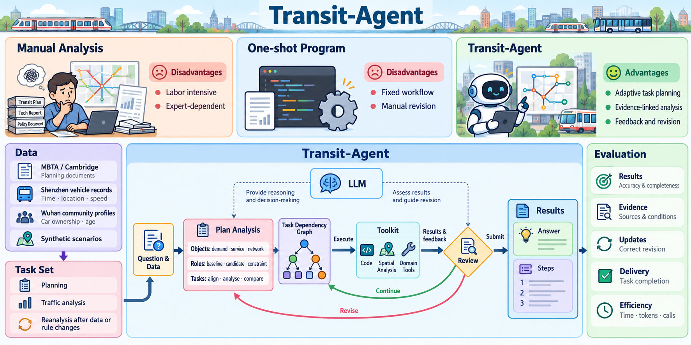

<p align="center">
  
</p>

<h1 align="center">Transit-Agent: An Autonomous Planning Agent for Urban Transportation Analysis</h1>

<p align="center">
  English · <a href="README_zh-CN.md">简体中文</a>
</p>

## Overview



Transit-Agent turns transportation questions into executable analysis tasks. It identifies objects, roles, and task types, organizes tasks in a dependency graph, and combines domain tools with code to carry out analysis. Results and execution feedback guide whether to continue, revise the plan, or submit an answer together with the analysis steps and supporting evidence.

## Contributions

- Autonomous analysis planning: organize transportation analysis around objects, roles, and task types, manage computations and result dependencies through a task graph, and revise the analysis in response to feedback.
- Domain tools and code: combine reusable capabilities for sample comparisons, sustained change detection, and spatial analysis with model-generated code for task-specific computations.
- Task set and evaluation: use planning documents, vehicle observations, residential community profiles, and synthetic scenarios to construct analysis, scenario comparison, and update tasks. Evaluate answers, evidence, revisions, task completion, and resource costs.

## Quickstart

Use Python 3.11. From the repository root, create a virtual environment:

```bash
python -m venv .venv
```

Activate it with `.venv\Scripts\Activate.ps1` in Windows PowerShell, or `source .venv/bin/activate` on Linux / macOS.

Install dependencies and check the example materials:

```bash
python -m pip install -r requirements.txt
python -X utf8 -m traffic_agent.planning --data-dir traffic_agent/examples/planning_demo --question "Check whether these materials support a bus stop adjustment analysis" --prepare-only
```

The example uses synthetic materials to demonstrate the data interface. This check does not call a model API.

After preparing your own materials, start an analysis through the current bus planning entry point:

```bash
python -X utf8 -m traffic_agent.planning --data-dir data/my_case --question "Analyse how the bus stop changes affect access, and produce a results table and map" --model deepseek-flash --temporary-key
```

You will be prompted for an API key. The program saves the results page, analysis code, and run records under `data/planning_runs/`.

See the [detailed planning guide (Chinese)](docs/Usage_zh-CN.md#准备自己的资料) for the data format and further usage. The Quickstart covers the current planning prototype.
