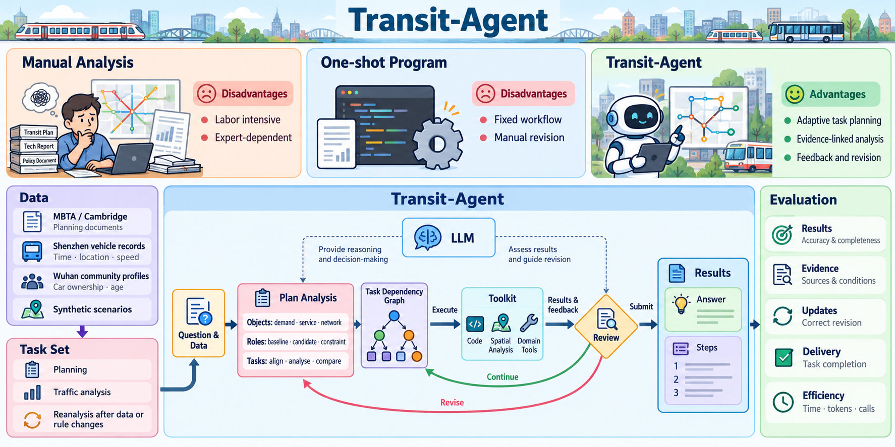

<p align="center">
  
</p>

<h1 align="center">Transit-Agent：面向动态数据的城市交通分析智能体研究</h1>

<p align="center">
  <a href="README.md">English</a> · 简体中文
</p>

## 项目概览



Transit-Agent 结合交通领域 Context、可执行的专业工具和数据依赖图，回答城市交通分析问题。模型选择方法并解释结果，工具完成空间与交通计算，依赖图记录输入及结果之间的关系。当资料或参数发生变化时，更新受影响的计算，复用仍然有效的结果。

## 实现思路

- 交通领域 Context：在规划提示中加入九类交通概念、六类功能角色，以及运营时刻、换乘、旅行时间目标、高峰时段和路网约束等专业规则。具体地点、时间和约束从问题与资料中获取。
- 专业工具：提供十一项具名工具，覆盖 GTFS 读取、地理编码、空间处理、网络分析、考虑时刻表的路径规划、OD 分析与可达性分析。其他计算可由模型编写 Python 完成。
- 数据依赖链：专业工具调用具有稳定的任务编号，通过文件或上游结果引用建立依赖。再次请求某条分析分支时，检查输入版本和参数，重算受影响的步骤，复用未变化的结果。继续会话时保留依赖图及工具产出。

### 交通领域 Context

| 层次 | 内容 |
|---|---|
| 交通领域概念 | 交通方式、地理位置、交通网络、线路与路径、运营服务、出行需求、交通供给、运行表现、交通事件 |
| 功能角色 | 出发地、目的地、分析范围、时间约束、交通方式、出行约束 |
| 专业规则 | 服务日与运营时段、换乘中的步行和候车、距离与旅行时间的区别、高峰差异、网络方向性与连通性及容量、班次时刻约束 |

Context 定义在 [`agent/domain_context.py`](agent/domain_context.py)，每次规划会话都会加载。

面向模型的 Context 和动作接口使用英文，用户输入及来源资料保留原文，同时兼容旧版中文动作接口。

### 可执行的专业工具

| 类别 | 工具 | 输入与计算 |
|---|---|---|
| 数据获取 | GTFS Reader | 按指定服务日读取本地 GTFS ZIP，应用服务日历与日期例外，生成包含到发时刻的有向网络。 |
| 空间处理 | Geocoding、Spatial Search、Buffer、Overlay | 在给定地名地址表中匹配位置，查询附近要素，构建米制缓冲区，对图层求交。 |
| 网络分析 | Shortest Path、K-shortest Path、Network Analysis | 按给定距离或旅行时间权重计算路径，检查有向网络的连通结构。 |
| 出行分析 | Multimodal Routing、OD Analysis、Accessibility | 结合候车与换乘计算到达时间，生成 OD 出行时间结果，查询时间预算内可达的目的地。 |

空间工具使用 WGS84 GeoJSON，涉及距离时需提供适合研究区的米制投影坐标系。地理编码在用户提供的点状地名地址表中精确匹配，重名时返回全部候选。空间距离是该投影下的几何距离。

路径计算使用显式的有向网络。静态最短路径比较边权，考虑时刻表的路径工具依据出发时刻与换乘约束计算。步行连接需由资料提供。GTFS 读取支持定时班次、日历例外及跨午夜时刻，按频率发车、按需服务或暂未支持的换乘形式会返回具体输入错误。参数定义见 [`transit_network.py`](agent/tools/transit_network.py) 和 [`transit_spatial.py`](agent/tools/transit_spatial.py)。

### 带依赖关系的工具调用

模型可先读取 GTFS，再引用生成的网络规划出行：

```json
{"action":"professional_tool","task":"feed","tool":"GTFS Reader","params":{"file":"feed.zip","service_date":"2026-11-11"},"reason":"Read scheduled trips for the selected service day"}
```

```json
{"action":"professional_tool","task":"route_a","tool":"Multimodal Routing","params":{"graph":{"result":"feed","path":["graph"]},"origin":"A","destination":"B","departure_seconds":28800,"transfer_min_seconds":120,"max_transfers":2},"reason":"Find a feasible itinerary for the departure time"}
```

其中 `A`、`B` 为所提供 GTFS 中的站点编号。第二次调用会记录对 `feed` 的依赖，其他依据资料可通过 `"file_dependencies":["guide.json"]` 声明。输入更新后，沿依赖关系处理受影响分支。依赖追踪覆盖注册专业工具及其声明的输入，任意 Python 代码另行执行。

## 快速开始

使用 Python 3.11，在项目根目录创建虚拟环境：

```bash
python -m venv .venv
```

激活环境：Windows PowerShell 使用 `.venv\Scripts\Activate.ps1`；Linux / macOS 使用 `source .venv/bin/activate`。

安装依赖，运行离线的依赖更新示例：

```bash
python -m pip install -r requirements.txt
python -m agent.tool_demo
```

示例修改两个虚构交通网络中的一个，展示哪次路径计算需要重算、哪次可以复用。资料保存在临时目录，无需模型 API 或密钥。

检查规划资料接口：

```bash
python -X utf8 -m agent.planning --data-dir benchmark/demo/data --question "检查资料是否具备开展站点调整分析的条件" --prepare-only
```

该示例使用虚构资料演示读取接口，检查过程不调用模型 API。

准备自己的资料后，通过规划入口启动分析：

```bash
python -X utf8 -m agent.planning --data-dir data/my_case --question "分析站点调整对到站条件的影响，提交结果表和地图" --model deepseek-flash --temporary-key
```

程序会提示输入 API 密钥，并将结果页、分析代码及运行记录保存到 `data/planning_runs/`。

更新资料后继续已有会话：

```bash
python -X utf8 -m agent.planning --continue-from data/planning_runs/<previous-run> --data-dir data/my_case --question "根据更新后的资料修订分析" --temporary-key
```

每次新运行独立保存 `tool_graph.json` 和 `tool_results/`，工具反馈记录实际计算与复用情况，原会话结果保留在原目录。

运行离线软件测试：

```bash
python -m unittest discover -s tests -v
```

## 仓库结构

```text
agent/                  模型配置与智能体规划循环
  domain_context.py     交通概念、功能角色与专业规则
  tool_graph.py         工具依赖、输入版本与结果复用
  tool_demo.py          虚构资料更新的离线示例
  tools/                交通、空间及代码执行工具
benchmark/              评测框架
  questions/            评测题目
  references/           参考流程与答案
  demo/                 虚构资料接口示例
evaluate/              评测入口
tests/                 软件回归测试
```

`agent/models.py` 保存模型适配与凭据读取逻辑，`agent/runtime.py` 保存模型请求设置与共用提示。`agent/planning.py` 将领域 Context、专业工具、依赖图与动作循环连接起来。

## 评价

仓库分别组织评测题目、参考资料和评分代码。公开的 `benchmark/questions/` 与 `benchmark/references/` 目前为预留目录，随附的虚构示例与软件测试用于检查实现行为。

使用本地评分程序评测已有运行记录：

```bash
python -m evaluate.score --scorer /path/to/scorer.py --root /path/to/runs
```

评分程序提供 `score(root, output)` 函数，`root` 为运行目录，`output` 为新建的评分结果子目录，默认为 `scores`。评分程序的配套模块与参考资料沿用本地目录结构。
