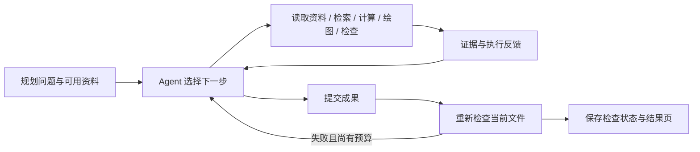

# Transit Inquiry｜公交规划调查 Agent

围绕真实公交规划问题，自主选择资料与分析方法，执行计算，并根据证据修正判断的研究原型。

**仓库建议名：`transit-inquiry`。当前版本：开发原型，2026-10-27。**

当前聚焦公交站点调整与到站可达性，以 MBTA / Cambridge Street 的规划文件、公众意见及空间数据开展案例研究。输入是一个规划问题，输出包括分析代码、结果表、空间图层、行动记录和可浏览的结果页。

## 研究问题

当规划问题所需的证据不完整、分析方法尚未确定时，Agent 如何选择下一项资料和计算，并把问题转化为可执行、可核查的分析过程？

例如：合并两个公交站后，哪些出行者的到站条件发生变化？现有公开数据能够说明哪些影响？什么证据会改变当前判断？

Agent 决定调查对象、资料和方法；程序负责执行计算、检查必要条件并返回结果。站点客流、住宅入口的条件影响和全部居民的平均影响分别解释。

## 已实现的能力

| 能力 | 当前实现 |
|---|---|
| 中文行动循环 | 用中文提出判断、选择动作、读取反馈、继续分析或提交 |
| 资料读取 | 按资料编号检索、分页读取原文，访问 CSV、JSON、GeoJSON 等原件 |
| 官方资料发现 | 检索及下载 Cambridge、MBTA、Mass.gov 和 Cambridge GIS 指定来源 |
| 代码分析 | 在独立 Python 进程执行模型生成的分析代码，记录结果与错误 |
| 空间展示 | 根据模型准备的图层生成局部地图，保留标签、来源和投影说明 |
| 空间必要条件检查 | 检查坐标解析、距离有限且非负、完整路径的直线下界和图层几何 |
| 修订与追问 | 检查失败返回模型处理；提交时重读成果检查；后续会话继承只读旧成果 |
| 过程记录 | 保存问题、提示、公开行动理由、代码、工具反馈和 token 用量 |



## 当前案例进展

Inman Square Apartments 案例用于调查站点调整对到站条件的影响。一次纠错运行发现旧表 30 条距离中有 9 条短于相同起终点的直线距离，并发现一条只有单个坐标的无效路径。

模型重新计算道路中心线路径及两端接入段后，30 条距离均通过下界检查；其中一条原来的零距离变为约 40.8 米。无效图层从最终成果中撤下。后续人行道计算超时，地图未完成，文字中仍出现错误归因与未经完整计算的方案判断。

这是一次开发性纠错观察。当前结果支持继续完善工具反馈与调查过程；Agent 相对于通用代码 Agent 或一次性程序的稳定优势仍需通过后续对照检验。上述距离是近似计算结果，检查通过不等于路径现场可通行或整份规划结论正确。

## 安装与不调用 API 的检查

在仓库根目录运行。建议 Python 3.11，并使用独立虚拟环境；`requirements.txt` 固定了当前验证环境中的依赖版本。

```bash
python -m venv .venv
```

激活环境：Windows PowerShell 使用 `.venv\Scripts\Activate.ps1`；Linux / macOS 使用 `source .venv/bin/activate`。随后执行：

```bash
python -m pip install -r requirements.txt
python -X utf8 -m traffic_agent.planning --help
python -X utf8 -m traffic_agent.planning --data-dir traffic_agent/examples/planning_demo --question "检查资料是否具备开展站点调整分析的条件" --prepare-only
python -X utf8 -m unittest discover -s tests -p test_planning.py
python -X utf8 -m unittest discover -s tests -p test_spatial_checks.py
```

`planning_demo` 是虚构的最小资料接口示例，用于检查目录与读取方式，不是 MBTA 实验数据。测试中的真实历史文件回归项在文件不存在时跳过，其余测试使用临时文件与明确标注的模型替身。以上检查不调用大模型 API。

绘图自动选择已安装的中文字体；若出现缺字，请安装 Noto Sans CJK SC 等中文字体。当前适配尚未完成 Linux / macOS 的实际运行验证。

## 准备自己的资料

数据目录使用如下结构：

```text
data/my_case/
  目录.json
  资料.py
  规划文件.txt
  站点.csv
  道路.geojson
```

可从 `traffic_agent/examples/planning_demo/` 复制 `资料.py` 与目录格式，再替换为自己的文件。每项资料记录编号、标题、状态、原始文件、提取文本和来源。文本含分页时，读取器识别 `【原文第1页】` 形式的标记。PDF 下载工具生成的正文也可直接按字符范围读取。

目前完整的 MBTA 资料包及其自动下载、版本固定流程尚未整理为公开入口。真实案例原件、历史会话和研究者复核材料保留在研究工作区，首版候选源码不包含这些文件。复现上述真实案例还需要取得对应版本的原始数据。

## 启动分析

当前规划入口使用 DeepSeek 接口。先准备资料，再在交互式终端中运行：

```bash
python -X utf8 -m traffic_agent.planning --data-dir data/my_case --question "请调查这次站点调整如何影响到站条件，自主选择资料与分析方法，提交结果表和地图" --model deepseek-flash --temporary-key
```

`--temporary-key` 会提示输入密钥，不回显、不保存。也可以通过 `DEEPSEEK_API_KEY` 环境变量配置凭据。不要把密钥写入命令参数、源码、任务文本或资料文件；程序不自动读取 `.env` 文件。

每次运行在 `data/planning_runs/` 创建新目录，包含 `结果.html`、`轨迹.json`、`会话.json`、执行代码及模型生成的文件。后续追问可用：

```bash
python -X utf8 -m traffic_agent.planning --continue-from data/planning_runs/某次运行目录 --question "请继续核查上一轮未解决的问题" --temporary-key
```

默认预算为最多 14 次模型请求、10 次代码执行、累计代码运行 360 秒、6 次联网动作，以及输入 300,000 / 输出 48,000 tokens。失败动作也计入相应预算。配置集中在 `traffic_agent/planning.py`。

## 从哪里理解和修改代码

| 文件 | 作用 |
|---|---|
| `traffic_agent/planning.py` | 中文提示、动作分派、预算控制、提交复查和结果页 |
| `traffic_agent/planning_tools.py` | 官方来源检索、下载、正文提取和绘图 |
| `traffic_agent/spatial_checks.py` | 距离与几何必要条件检查；不包含案例标准答案 |
| `traffic_agent/planning_worker.py` | 保护继承成果和下载原件 |
| `traffic_agent/models.py` | 凭据读取及早期模型适配接口 |
| `scripts/run_cambridge_harvard_r2.py` | 当前入口复用的请求、提示与预算辅助函数，保留历史实验脚本名称 |
| `scripts/cambridge_code_worker_v3.py` | 分析代码执行环境与访问限制 |
| `tests/test_planning.py`、`tests/test_spatial_checks.py` | 工具、读取保护、空间检查与失败退回测试 |

可先从 `planning.py` 的 `PROMPT` 和 `run()` 阅读“模型选动作—工具执行—反馈进入下一轮”的过程，再修改工具。记录中的“当前判断”和“理由”是公开行动说明，不是模型隐藏思维链。

## 当前使用范围

- 主要面向科研人员的本地开发与复核。规划入口会执行模型生成的 Python；当前访问限制不构成面向不可信代码的完整安全隔离，公开部署服务需要独立执行隔离。
- 模型主要读取文字与结构化数据，当前不直接查看规划图纸像素。站位、过街条件和无障碍通行需要匹配相应证据。
- 距离表检查需要声明原始起点记录、终点坐标、距离列及单位；它不自动发现所有表格，也不验证输入坐标确实代表规划站位。
- API 调用会发送问题及会话中的资料片段；请使用允许发送给所选服务的数据。代码执行子进程会过滤凭据类环境变量。

## 公开范围与后续工作

本工作区同时保存早期研究。根目录 `.gitignore` 采用明确文件清单，仅纳入当前核心代码、上述依赖脚本、两组测试、示例、依赖文件和本 README。原始数据、真实运行输出、旧报告、个人配置、缓存与凭据文件默认排除。

本地运行记录可能包含运行目录等环境信息，不能直接作为公开附件。发布时应只从清单中的候选文件整理仓库，并检查最终待提交内容；忽略规则不会移除已经被 Git 跟踪的文件。

下一阶段优先完成：

1. 真实案例资料获取说明与数据版本记录。
2. 人行道网络计算效率、路径几何与结果表的一致性核查。
3. 将文字判断与实际读取证据、完成的计算对应起来。
4. 在不同类型的站点调整案例中，与一次性程序、通用代码 Agent 开展同条件比较。

代码许可证将在正式发布前确定。第三方资料按各来源的使用与再分发条款处理。
